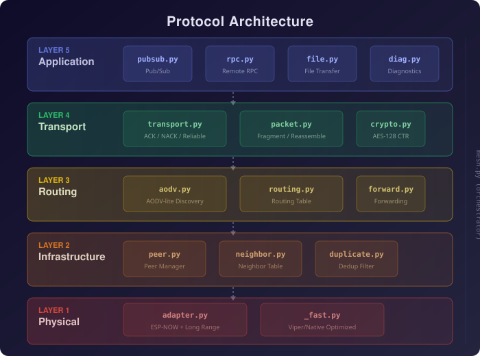

<p align="center">
  
</p>

<p align="center">
  <a href="LICENSE"></a>
  
  
  
  <a href="CONTRIBUTING.md"></a>
</p>

<p align="center">
  <b>Production-ready mesh networking for ESP32 MicroPython devices.</b><br>
  Complete 5-layer protocol stack over ESP-NOW. Zero dependencies. ~18 KB RAM.
</p>

---

## Why Mycelium?

Like the underground fungal networks that connect entire forests, Mycelium creates resilient, self-healing mesh networks between ESP32 devices.

- **Complete Protocol Stack** — 5 layers (Physical through Application) in a single library
- **AODV-lite Routing** — On-demand route discovery with expanding ring search
- **Reliable Delivery** — Fragmentation, ACK/NACK, and automatic retransmission
- **Built-in Services** — Pub/Sub, RPC, File Transfer, and Diagnostics out of the box
- **AES-128 CTR Encryption** — Per-packet nonce, pre-shared key, zero-alloc encrypt/decrypt
- **Viper Optimized** — Critical paths hit 125k pkt/s encode/decode on ESP32
- **Tiny Footprint** — ~18 KB RAM, zero external dependencies
- **Wide Hardware Support** — ESP32, S2, S3, C3 with optional Long Range mode

## Architecture

<p align="center">
  
</p>

| Layer | Name | Modules | Responsibility |
|-------|------|---------|----------------|
| **5** | Application | `pubsub.py` `rpc.py` `file.py` `diag.py` | Pub/Sub, RPC, File Transfer, Diagnostics |
| **4** | Transport | `transport.py` `packet.py` `crypto.py` | Reliable delivery, fragmentation, encryption |
| **3** | Routing | `aodv.py` `routing.py` `forward.py` | AODV-lite route discovery, forwarding engine |
| **2** | Infrastructure | `peer.py` `neighbor.py` `duplicate.py` | Peer management, neighbor tracking, dedup |
| **1** | Physical | `adapter.py` `_fast.py` | ESP-NOW I/O, viper-optimized codec |

`mesh.py` orchestrates all layers and provides the unified API.

## Quick Start

### Installation

Copy the `umesh/` directory to your ESP32:

```bash
# Using mpremote
mpremote connect /dev/ttyUSB0 cp -r umesh/ :umesh/

# Using Thonny
# Drag and drop the umesh/ folder to your device
```

### Minimal Example

```python
import asyncio
from umesh.mesh import Mesh
from umesh.config import MeshConfig

async def main():
    mesh = Mesh(MeshConfig(channel=6))
    await mesh.start()

    # Send a message to node 0x0002
    await mesh.send(0x0002, b"Hello mesh!")

    # Keep running
    while True:
        await asyncio.sleep(1)

asyncio.run(main())
```

### With Message Handler

```python
import asyncio
from umesh.mesh import Mesh
from umesh.config import MeshConfig

async def main():
    mesh = Mesh(MeshConfig(channel=6))

    # Register callback for incoming data
    def on_message(src_id, payload, rssi):
        print(f"From 0x{src_id:04X}: {payload} (RSSI: {rssi})")

    mesh.on_data(on_message)
    await mesh.start()

    while True:
        await asyncio.sleep(1)

asyncio.run(main())
```

### Encrypted Mesh

```python
from umesh.config import MeshConfig

config = MeshConfig(
    channel=6,
    enable_encryption=True,
    psk=b"16-byte-key!!!!!"  # Exactly 16 bytes
)
```

All nodes must share the same PSK. Encryption is transparent — the API stays identical.

## Features

### Pub/Sub Messaging

```python
# Subscriber node
mesh.subscribe("sensors/temp", lambda topic, data, src:
    print(f"{topic}: {data}"))

# Publisher node
mesh.publish("sensors/temp", b"23.5")
```

### Remote Procedure Call (RPC)

```python
# Server node
mesh.rpc_register("get_temp", lambda: b"23.5")

# Client node
result = await mesh.rpc_call(0x0002, "get_temp")
print(result)  # b"23.5"
```

### File Transfer

```python
# Sender
await mesh.send_file(0x0002, "config.json", file_data)

# Receiver
mesh.on_file(lambda name, data, src:
    print(f"Received {name} ({len(data)} bytes)"))
```

### Diagnostics

```python
# Ping a node
rtt = await mesh.ping(0x0002)
print(f"RTT: {rtt} ms")

# Network statistics
stats = mesh.stats()
```

## Packet Format

14-byte header with up to 236 bytes payload (250 bytes total — ESP-NOW limit):

```
 0         1         2    3    4    5    6    7    8    9   10   11   12   13
+---------+---------+----+----+----+----+----+----+----+----+----+----+----+----+
| Ver|Type| Flags   | Packet ID |TTL |Hops| Source ID | Dest ID   | Frag Info  |CRC8|
+---------+---------+-----------+----+----+-----------+-----------+--------+---+----+
  4b  4b     8b        16b       8b   8b     16b         16b       12b+4b+4b+4b  8b
```

16 packet types: DATA, DATA_FRAG, ACK, NACK, RREQ, RREP, RERR, HELLO, PING, PONG, TOPO, SYNC, PUB, SUB, RPC, CTRL.

## Configuration

All parameters are set via `MeshConfig`:

| Parameter | Type | Default | Description |
|-----------|------|---------|-------------|
| `node_id` | `int` | auto | 16-bit node ID (derived from MAC if `None`) |
| `channel` | `int` | `1` | WiFi channel (1-14) |
| `lr_mode` | `bool` | `False` | Enable ESP-NOW Long Range mode |
| `hello_interval` | `int` | `10000` | HELLO beacon interval (ms) |
| `route_timeout` | `int` | `120000` | Route entry expiration (ms) |
| `max_ttl` | `int` | `7` | Maximum Time-To-Live (1-15) |
| `peer_slots` | `int` | `19` | Maximum ESP-NOW peer slots (1-19) |
| `rx_buf` | `int` | `2048` | Receive buffer size (bytes) |
| `duplicate_window` | `int` | `32` | Duplicate detection window size |
| `enable_encryption` | `bool` | `False` | Enable AES-128 CTR encryption |
| `psk` | `bytes` | `None` | Pre-Shared Key (16 bytes) |

## Performance

| Metric | Value |
|--------|-------|
| Packet encode/decode | ~8 us / 125k pkt/s |
| Duplicate check | ~5 us / 200k checks/s |
| RAM footprint | ~18 KB (default config) |
| Max message size | 3,540 bytes (15 fragments) |
| Max TTL | 15 hops |
| Addressable nodes | 65,534 (16-bit) |

## Hardware Support

| Board | Standard | Long Range | Notes |
|-------|----------|------------|-------|
| ESP32 | Yes | No | Original silicon |
| ESP32-S2 | Yes | Yes | |
| ESP32-S3 | Yes | Yes | Recommended |
| ESP32-C3 | Yes | Yes | RISC-V core |

**Requirements:** MicroPython >= 1.20

## Project Structure

```
mycelium/
  umesh/                  # Core library
    __init__.py
    mesh.py               # Main orchestrator
    config.py             # MeshConfig with validation
    const.py              # Protocol constants
    adapter.py            # ESP-NOW adapter (Layer 1)
    _fast.py              # Viper/native optimized codec
    peer.py               # Peer manager (Layer 2)
    neighbor.py           # Neighbor table (Layer 2)
    duplicate.py          # Duplicate filter (Layer 2)
    aodv.py               # AODV-lite route discovery (Layer 3)
    routing.py            # Routing table (Layer 3)
    forward.py            # Forwarding engine (Layer 3)
    packet.py             # Packet codec (Layer 4)
    transport.py          # Reliable transport (Layer 4)
    crypto.py             # AES-128 CTR encryption (Layer 4)
    pubsub.py             # Pub/Sub messaging (Layer 5)
    rpc.py                # Remote Procedure Call (Layer 5)
    file.py               # File transfer (Layer 5)
    diag.py               # Diagnostics (Layer 5)
    utils.py              # Shared utilities
  tests/                  # Test suite (CPython)
  examples/               # Example scripts
  docs/                   # Documentation
```

## Examples

### Layer 1 — Physical

| Example | Description |
|---------|-------------|
| `01_adapter_basic.py` | Broadcast communication between ESP32 nodes |
| `02_adapter_unicast.py` | Point-to-point unicast with peer registration |

### Layer 2-3 — Infrastructure & Routing

| Example | Description |
|---------|-------------|
| `neighbor_example.py` | Neighbor discovery and RSSI tracking |
| `duplicate_filter_example.py` | Duplicate packet detection |
| `forwarding_example.py` | Multi-hop packet forwarding |

### Layer 4 — Transport

| Example | Description |
|---------|-------------|
| `transport_example.py` | Reliable delivery with ACK/retransmit |
| `crypto_example.py` | Encrypted mesh communication |
| `fast_example.py` | Viper-optimized codec benchmarks |
| `packet_demo.py` | Packet encoding/decoding demo |

### Layer 5 — Application

| Example | Description |
|---------|-------------|
| `example_pubsub.py` | Pub/Sub topic messaging |
| `rpc_example.py` | Remote Procedure Call |
| `file_transfer_example.py` | File transfer between nodes |
| `example_diagnostics.py` | Ping, stats, topology |

### Integration

| Example | Description |
|---------|-------------|
| `simple_mesh.py` | Minimal mesh setup |
| `complete_example.py` | Full-featured mesh node |
| `custom_config.py` | Custom configuration options |

## Documentation

- [Packet Module](docs/packet_module.md) — Packet format and codec API
- [Pub/Sub Integration](docs/PUBSUB_INTEGRATION.md) — Pub/Sub messaging guide
- [File Transfer Flow](docs/file_transfer_flow.md) — File transfer protocol details

## Contributing

Contributions are welcome! See [CONTRIBUTING.md](CONTRIBUTING.md) for guidelines.

## Security

For security concerns and vulnerability reporting, see [SECURITY.md](SECURITY.md).

## License

This project is licensed under the Apache License 2.0 — see the [LICENSE](LICENSE) file for details.

## Acknowledgments

- [ESP-NOW](https://docs.espressif.com/projects/esp-idf/en/latest/esp32/api-reference/network/esp_now.html) by Espressif Systems
- [MicroPython](https://micropython.org/) project
- [AODV](https://www.rfc-editor.org/rfc/rfc3561) (RFC 3561) — inspiration for the routing protocol
